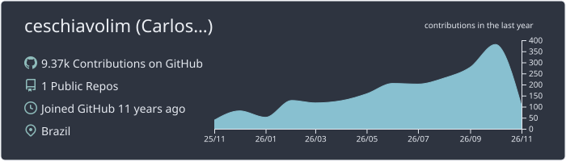

### 👨‍💻 Backend Developer | Software Engineer

---

## 👋 About Me | Sobre Mim

### 🇧🇷 Português

Sou desenvolvedor de software com mais de **15 anos de experiência**, especializado em desenvolvimento backend com **C# e .NET**.

Minha experiência envolve desenvolvimento e manutenção de sistemas corporativos, APIs REST, integrações entre plataformas, otimização de bancos de dados e modernização de aplicações legadas.

Gosto de resolver problemas complexos, melhorar a performance de aplicações e desenvolver soluções eficientes e sustentáveis.

### 🇺🇸 English

I'm a software developer with over **15 years of experience**, specializing in backend development with **C# and .NET**.

My experience includes enterprise software development, REST APIs, system integrations, database optimization, and legacy application modernization.

I enjoy solving complex problems, improving application performance, and building efficient, maintainable software solutions.

---

## 🛠️ Tech Stack | Tecnologias

### Languages & Frameworks

### Databases & Infrastructure

**SQL Server · ASP.NET Core · Web API · WCF · Dapper**

### Development Tools

**JetBrains DataGrip · RedisInsight · IIS**

---

## 🚀 What I Do | Áreas de Atuação

| 🇧🇷 Português | 🇺🇸 English |
|---|---|
| Desenvolvimento de APIs REST | REST API Development |
| Arquitetura de aplicações backend | Backend Application Architecture |
| Integração entre sistemas | System Integration |
| Otimização de SQL Server | SQL Server Optimization |
| Modernização de sistemas legados | Legacy System Modernization |
| Análise e resolução de problemas | Troubleshooting & Problem Solving |
| Automação de processos | Process Automation |

---

## 📊 GitHub Statistics | Estatísticas

> 📌 GitHub statistics reflect public repository activity and may not represent all professional development experience.
>
> As estatísticas refletem a atividade dos repositórios públicos e podem não representar toda a experiência profissional.

---

## 🎮 Personal Projects | Projetos Pessoais

Besides enterprise software development, I enjoy creating tools, automations, and game-related projects.

Além do desenvolvimento de sistemas corporativos, gosto de criar ferramentas, automações e projetos relacionados a jogos.

---

## 🌐 Connect With Me | Contato

---

### 💡 Clean Code • Performance • Continuous Learning

*Building software, solving problems, and always learning.*

*Desenvolvendo soluções, resolvendo problemas e aprendendo sempre.*

